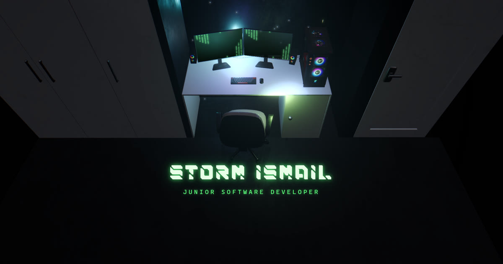
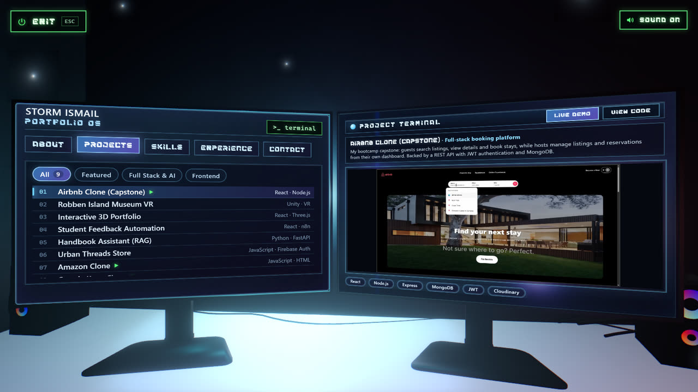

# Interactive 3D Portfolio

This is my portfolio website, and instead of a normal scrolling page it's a 3D room with my desk setup in it. I modelled the room, desk, PC and monitors in Blender, and the site renders them in the browser with React Three Fiber. You click Start, the camera flies in to the monitors, and the monitors run a little "Portfolio OS" with my projects, skills, experience and contact details. It was inspired by my love for gaming.

**Live:** https://portfolio-website-six-sigma-80.vercel.app



## What it does

- **The room:** a 3D desk setup with RGB lighting on the PC and speakers that cycles through colours, dust floating in the light, and Matrix rain on the monitors while they're idle
- **Start:** the camera flies in, the monitors flicker on and type out a fake BIOS boot, and then the Portfolio OS menu comes up
- **Left monitor:** tabs for About, Projects, Skills, Experience and Contact. The Projects tab is a list you can filter by category
- **Right monitor:** hover a project on the left and the right monitor shows it: a screen recording, a description, the tech stack and Live demo / View code buttons
- **Sound:** a room hum, a CRT power-on sound, key clicks and a power-down sound. It's all generated in the browser with the Web Audio API, so there are no audio files, and there's a mute button
- **Hidden terminal:** click the keyboard on the desk and you get a command line instead. Try `help`, `projects`, `skills`, `cv` or `sudo hire storm`
- **Phones:** the 3D scene doesn't work well on phones, so they get a simple version with my details and projects instead



## Tech

- **React** + **Vite**
- **Three.js** through **React Three Fiber** and **drei** for the 3D scene
- **@react-three/postprocessing** for the bloom and vignette
- **Blender** for all the 3D models
- **Web Audio API** for the sounds
- Hosted on **Vercel**, with Vercel Analytics

## What's in here

```
PortfolioWebsite/
├── src/
│   ├── App.jsx                  decides phone version vs 3D version
│   ├── PortfolioScene.jsx       the 3D scene, the camera moves, Start/Exit and the state
│   ├── data/                    all the text: profile, about/skills/experience, projects
│   ├── components/
│   │   ├── models/              the Blender models (desk, chair, room, monitors)
│   │   ├── lighting/            lights, RGB cycling, dust, post-processing
│   │   ├── MonitorUI.jsx        the left monitor's Portfolio OS
│   │   ├── rightMonitor/        the right monitor's project showcase
│   │   ├── terminal/            the hidden terminal and its commands
│   │   └── MobileFallback.jsx   the phone version
│   └── audio/soundEngine.js     every sound on the site
├── public/
│   ├── models/                  the compressed .glb models the site loads
│   ├── videos/, images/         project screen recordings and thumbnails
│   └── StormIsmailCV_01.pdf     my CV
└── models-source/               the original uncompressed models from Blender
```

## Running it yourself

```bash
npm install
npm run dev
```

Then open the link Vite gives you. To change any of the text (projects, skills, experience, contact details), you only need to edit the files in `src/data/`.

## Challenges I ran into (and how I fixed them)

**The models were way too big.** The first version loaded about 52MB of 3D models, and the chair alone had 40 textures at full size, so the site took forever to load. I compressed the models and shrank the textures, which got it down to about 2.7MB, and added a loading screen while they download. The monitors were a special case: compressing them changed their scale, which made the screens' UI shrink, so those ones only get their textures compressed.

**The screens floated off the monitors on iPhones.** The monitor screens are real HTML positioned in 3D, and Safari on iPhone puts them in the wrong place. Since the 3D desk doesn't really suit a small phone screen anyway, I made phones get a proper 2D version of the portfolio instead, which also means they don't have to download any of the 3D.

**A white screen on my own machine.** Locally, the site would load and then go white with a "Context Lost" error. It turned out to be React's StrictMode, which mounts everything twice in development to catch bugs. React Three Fiber took that fake unmount as real and shut down the 3D renderer. Removing StrictMode fixed it (it never runs on the live site anyway).

**Blurry text on the monitors.** Because the screens are HTML scaled up onto the 3D monitors, the browser was drawing the text small and then stretching it. I now lay the screens out three times bigger and scale them back down, so the text comes out sharp.

**The monitors got cut off on some screens.** The camera angles were set up on my monitor, so on MacBook-shaped screens the edges of the monitors were cut off. Now the camera works out the shape of your screen and steps back just enough to fit both monitors.

**Visitors could zoom out of the room.** On the landing screen you could scroll and drag the camera right out of the room and see the parts that aren't modelled. The camera is now locked, so it only moves when you click something.

## What I'd improve next

- A proper 3D version for phones, instead of the 2D fallback
- Screen recordings for the rest of my projects
- A short write-up for each of my main projects, about how I built it and what I learned
